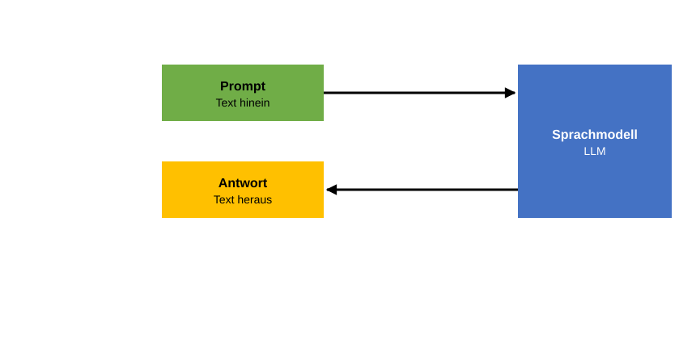

# Was ein Agent ist

> **Stand der Quellen:** [referenzprozess-softwareentwicklung](https://github.com/schlingensiepen/referenzprozess-softwareentwicklung) `release-2.0`, `docs/Einfuehrung.md`.

> **Ein Agent ist ein LLM mit einem Harness, und der Harness kann Tools aufrufen.**

Dieser Satz ist das ganze Kapitel. Er enthält drei Wörter, die Sie noch nicht kennen müssen: LLM, Harness, Tool. Statt sie zu definieren, bauen wir den Agenten in Stufen auf. Jede Stufe fügt der vorigen genau eine Sache hinzu. Am Ende sehen Sie, dass ein [Agent](../Z-anhang/Z010-glossar.md#agent) keine Zauberei ist, sondern ein Sprachmodell und ein gewöhnliches Programm, die sich abwechseln. Wer das verstanden hat, kann später jedes Verhalten eines Agenten auf eine der Stufen zurückführen.

## Stufe 1: Das Sprachmodell

Ein [Sprachmodell](../Z-anhang/Z010-glossar.md#llm), englisch Large Language Model, kurz LLM, ist ein trainiertes Modell, das zu einem Text die wahrscheinliche Fortsetzung erzeugt. Mehr tut es nicht. Geben Sie ihm „Hänsel und Gretel gingen in den Wald“, schreibt es weiter: „es war so dunkel und so bitterkalt“. Es schreibt, was nach allem, was es beim Training gelesen hat, am ehesten folgt.

Text hinein, Text heraus. Der Text, der hineingeht, heißt [Prompt](../Z-anhang/Z010-glossar.md#prompt). Der Text, der herauskommt, ist die Antwort. Wie ein Modell zu dieser Fähigkeit kommt, steht im Hintergrundkapitel [Wie Maschinen lernen](../X-hintergrund/X010-wie-maschinen-lernen.md). Für dieses Kapitel genügt das Bild von Eingang und Ausgang.

**Das Modell allein: Text rein, Text raus.** Das Sprachmodell bekommt einen Prompt und liefert eine Antwort. Es führt nichts aus, es schreibt nur weiter.

Beim Training hat das Modell sehr viel Text gelesen und dabei zweierlei aufgenommen: wie Sprache funktioniert und was in den Texten stand. Das zweite ist das Wissen des Modells, und es hat einen Haken: Es ist auf dem Stand des Trainings. Kurz nach einer Wahl nennt ein Modell auf die Frage nach dem Bundeskanzler den alten. Es kann nichts wissen, was nach seinem Training geschehen ist. Merken Sie sich diese Schwäche, sie treibt den weiteren Aufbau.

## Stufe 2: Der Chatbot

Ein [Chatbot](../Z-anhang/Z010-glossar.md#chatbot) ist ein Sprachmodell mit einem Eingabefeld. Sie tippen, es antwortet. Es antwortet, aber es handelt nicht: Es liest keine Datei und führt keinen Befehl aus.

Dass sich ein Gespräch über mehrere Fragen trägt, liegt nicht daran, dass sich das Modell etwas merkt. Bei jeder neuen Frage schickt der Chatbot das gesamte bisherige Gespräch noch einmal mit. Fragen Sie nach dem VW Käfer und danach „Und was war mit den blauen?“, dann ergibt die zweite Frage nur Sinn, weil die erste im Prompt steht. Alles, was dem Modell bei einer Antwort vorliegt, heißt [Kontext](../Z-anhang/Z010-glossar.md#kontext). Der Platz dafür ist begrenzt. Was das für Ihre Arbeit bedeutet, ist das Thema des nächsten Kapitels.

## Stufe 3: Reasoning

Ein Modell, wie es bisher beschrieben ist, schreibt auf eine Aufgabe sofort die Antwort. Heutige Modelle können vor der Antwort Zwischenschritte aufschreiben und eine Aufgabe so in Stufen lösen. Diese Fähigkeit heißt [Reasoning](../Z-anhang/Z010-glossar.md#reasoning). Sagen Sie „Plan doch mal“, kommt ein Plan heraus, Schritt für Schritt. Sie wurde dem Modell nachträglich antrainiert; auch dazu mehr im Hintergrundkapitel.

Für den Agenten ist Reasoning aus einem Grund wichtig: Man kann das Modell jetzt etwas anderes fragen als nach der Antwort. Man kann fragen, welcher nächste Schritt es der Antwort näherbringt. Darauf baut die nächste Stufe.

## Stufe 4: Tools

> **Das Wissen im Sprachmodell ist eigentlich Verschmutzung, denn es muss veralten. Aktuelles Wissen holt der Agent über Tools in den Kontext.**

Zurück zur Schwäche aus Stufe 1. Die Lösung ist einfach: Steht die aktuelle Information im Prompt, antwortet das Modell richtig. Schreibt jemand hinein, wer gestern gewählt wurde, nennt das Modell den neuen Bundeskanzler. Die Frage ist nur, wer das hineinschreibt. Genau das leistet ein [Tool](../Z-anhang/Z010-glossar.md#tool): eine Fähigkeit, die dem Modell angeboten wird, etwa eine Web-Recherche, eine Datei lesen oder einen Befehl ausführen. Das Tool holt die Information, und sie landet im Prompt.

Dafür braucht es zwei Dinge. Erstens muss das Modell wissen, welche Tools es gibt. Vorn im Prompt steht darum für jedes Tool eine Gebrauchsanweisung: der Name, die Parameter, und was jeder Parameter bedeutet. Wer schon programmiert, kennt das als Kopf einer Funktion samt Dokumentation. Zweitens muss das Modell ein Tool anfordern können. Dazu legt der [Systemprompt](../Z-anhang/Z010-glossar.md#systemprompt), der Teil des Prompts, den nicht Sie schreiben, Folgendes fest: Das Modell darf statt einer Antwort auch Tool-Aufrufe zurückgeben, von denen es sich Informationen für die Aufgabe verspricht. Ein [Tool-Aufruf](../Z-anhang/Z010-glossar.md#tool-aufruf) ist eine feste Markierung im Text des Modells, dahinter der Name des Tools und die Parameter.

Das Entscheidende: Das Modell führt nichts aus. Es schreibt nur Text, wie in Stufe 1, und in diesem Text steht, dass es die Web-Recherche mit bestimmten Suchbegriffen aufrufen würde. Wer den Aufruf ausführt, kommt in der nächsten Stufe.

## Stufe 5: Der Harness

> **Der Harness ist das Zaumzeug des Modells: Er führt es, ohne selbst klug zu sein.**

Der [Harness](../Z-anhang/Z010-glossar.md#harness) ist das Programm um das Sprachmodell herum. Das Wort heißt wörtlich Zaumzeug, das Geschirr, mit dem man ein Pferd führt. Der Harness enthält keine eigene KI. Er tut deterministisch, was ihm einprogrammiert wurde:

1. Er stellt den Prompt zusammen: Systemprompt, Beschreibungen der Tools, bisheriges Gespräch, Ihr Auftrag.
2. Er schickt den Prompt an das Modell.
3. Er liest die Antwort und sucht darin die Markierungen für Tool-Aufrufe, so wie ein Interpreter in einem Programm die Befehle erkennt.
4. Findet er einen Tool-Aufruf, führt er das Tool aus und schreibt das Ergebnis in den nächsten Prompt.
5. Findet er keinen, zeigt er Ihnen die Antwort.

**Harness und Tools kommen dazu.** Der Harness ist ein Programm, das den Prompt baut, das Modell aufruft und die Tools bereithält. Das Modell bleibt außerhalb, der Harness redet mit ihm nur über Prompt und Antwort.

Harness und Modell sind zwei getrennte Teile. Der Harness läuft als Programm auf Ihrem Rechner, das Modell läuft in der Regel auf den Rechnern eines Anbieters (Stand Oktober 2026). Darum gibt es mehrere Harnesses, etwa Claude Code, Cursor oder Windsurf, und ein Harness kann verschiedene Modelle ansteuern. Die Arbeitsweise, die dieses Skript beschreibt, ist deshalb nicht an einen Anbieter gebunden; jeder Agent setzt die beschriebenen Abläufe mit seinen eigenen Tools um.

Ein Tool ist dabei gewöhnliche Software. Die Web-Recherche holt etwa die ersten fünf Treffer und gibt sie als Text zurück. Deshalb passen die Befehle eines Linux-Terminals so gut zu einem Agenten: Ein Befehl bekommt Text und Parameter hinein, liefert Text heraus, und dieser Text wandert unverändert in den Kontext.

## Stufe 6: Die Schleife

Jetzt fehlt nur noch, dass sich die Schritte des Harness wiederholen. Der Ablauf ist ein Ping-Pong zwischen Harness und Modell:

1. Der Harness baut den Prompt und schickt ihn an das Modell.
2. Das Modell antwortet. Enthält die Antwort Tool-Aufrufe, führt der Harness sie aus, baut aus den Ergebnissen den nächsten Prompt und geht zu Schritt 1.
3. Enthält die Antwort keinen Tool-Aufruf, ist die Runde zu Ende. Der Harness zeigt Ihnen die Antwort.

**Die Schleife: Tool-Ergebnis geht in den nächsten Prompt.** Aus der Antwort liest der Harness den Tool-Aufruf, führt ihn aus und legt das Ergebnis dem Modell im nächsten Prompt vor. Das wiederholt sich, bis eine Antwort ohne Tool-Aufruf kommt.

Ein Durchlauf am Beispiel: Sie fragen „Wer ist Bundeskanzler?“. Der Harness baut den Prompt: Systemprompt, Tool-Beschreibungen, Ihre Frage. Das Modell antwortet nicht mit einem Namen, sondern mit einem Tool-Aufruf: Web-Recherche, Suchbegriff „Bundeskanzler“. Der Harness führt die Suche aus und schreibt die Treffer in den nächsten Prompt. Jetzt antwortet das Modell mit dem aktuellen Namen, ohne Tool-Aufruf. Der Harness zeigt Ihnen diese Antwort. Die Antwort hängt vom Datum ab und stimmt trotzdem, weil das Wissen nicht aus dem Modell kam, sondern aus dem Tool.

Dasselbe Muster trägt die Arbeit an Software. Sagen Sie dem Agenten „Lies die Anforderungen an die Lagerverwaltung und fasse sie zusammen“, dann fordert das Modell das Tool zum Lesen der Datei an, der Harness legt ihm den Inhalt vor, und erst dann entsteht die Zusammenfassung. Eine Antwort kann auch mehrere Tool-Aufrufe enthalten. Was für Sie wie ein Schritt aussieht, sind oft viele Runden. Deshalb kann ein Agent lange arbeiten, ohne dass Sie etwas tun: Es bleibt der Chat-Modus, nur dass sich das Modell viele Runden lang mit den Ergebnissen seiner eigenen Tool-Aufrufe beschäftigt.

## Das ist die ganze Magie

> **Das Modell schreibt einfach nur Text weiter und markiert die Tool-Aufrufe. Das Programm drumherum führt es aus. Das ist die ganze Magie.**

Der Systemprompt muss dazu definieren, dass das LLM statt einer Antwort auch die Toolaufrufe zurückgeben kann, von denen es sich Informationen für das Abarbeiten der Aufgabe verspricht. Der Harness führt das aus und steckt das Ergebnis des Aufrufes in den nächsten Prompt. Das Tool kann dabei auch eine Web-Recherche sein.

Was jetzt klar sein sollte:

- Ein Sprachmodell schreibt Text weiter. Text hinein, Text heraus, nichts wird ausgeführt.
- Das Wissen im Modell veraltet. Aktuelles kommt über Tools in den Kontext.
- Ein Tool-Aufruf ist eine Markierung im Text des Modells. Ausgeführt wird er vom Harness, einem Programm ohne eigene KI.
- Der Agent ist die Schleife aus beidem: Prompt, Antwort, Tool, Ergebnis, nächster Prompt, bis eine Antwort ohne Tool-Aufruf kommt.

Ein Vorbehalt zum Schluss. Welche Modelle es gibt, wie groß der Kontext sein darf, welche Tools ein Harness mitbringt: All das ändert sich schnell. Der Aufbau aus diesem Kapitel bleibt, die Zahlen und Namen nicht.

> **Bei KI-Agenten gilt die Wahrheit immer nur für heute.**

Weiter mit [Kontext](A020-kontext.md): Was dem Modell je Runde vorliegt, warum der Platz dafür begrenzt ist und was das für Ihre Arbeit heißt.
