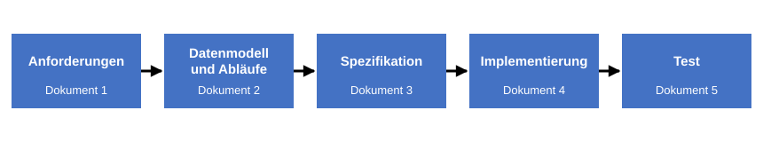

# Die Dokumentenkette

> **Stand der Quellen:** [referenzprozess-softwareentwicklung](https://github.com/schlingensiepen/referenzprozess-softwareentwicklung) `release-2.0`, `Vorgehen.md`, `docs/Referenzprozesse.md`.

> **Bezahlt wird der Weg von einem Zustand in den nächsten.**

Das Datenmodell einer Software beschreibt den Zustand der Welt, in unserem Beispiel also den Bestand des Lagers. Dafür alleine bezahlt aber niemand, der eine Software kauft. Bezahlt wird der Weg von einem Zustand in den nächsten, in unserem Fall das Einlagern, Auslagern und Reportieren. Denn Software soll ja genau Arbeitsabläufe unterstützen.

Im vorigen Kapitel ist eine Datei entstanden: `anforderungen.md`, die Anforderungen an die Lagerverwaltung. Zwischen dieser Datei und dem fertigen Programm liegen weitere Schritte, und der naive Ansatz macht aus jedem Schritt ein Dokument. Diese Folge von Dokumenten, jedes auf dem vorigen aufgebaut, heißt [Dokumentenkette](../Z-anhang/Z010-glossar.md#dokumentenkette). Dieses Kapitel zeigt, woher die Kette kommt und wie sie für die Lagerverwaltung aussieht. Die beiden folgenden Kapitel gehen sie ab.

## Zustand und Ablauf

Bevor die Kette kommt, eine Grundfigur, die Sie in jedem ihrer Dokumente wiederfinden: Es gibt einen Zustand der Welt, dann läuft etwas ab, dann gibt es einen neuen Zustand. Im Lager: Es liegen zehn Pakete am Lagerort, jemand lagert drei aus, es liegen sieben Pakete am Lagerort. Auf Papier ist das dasselbe mit einem Lagerbuch oder einer Karteikarte: Der Eintrag ist der Zustand, das Umschreiben ist der Ablauf.

Software bildet beides ab. Das Datenmodell aus dem vorigen Kapitel beschreibt den Zustand: Artikel, Lagerorte, Bestände. Die Abläufe sind die Funktionen, die von einem Zustand in den nächsten führen: Einlagern, Auslagern, Auswerten. Dabei wählt man den Ausschnitt der Realität so, dass er handhabbar bleibt. Für die Lagerverwaltung reichen die Artikelnummer und ein paar Eigenschaften, die Farbe der Verpackung interessiert niemanden.

## Die klassische Kette

Wie baut man Software? Die klassische Antwort ist eine feste Folge von Dokumenten:

1. **Anforderungen.** Was das Programm können muss und was es können kann. „Schnell“ ist keine Anforderung, solange nicht dabeisteht, woran man es misst.
2. **Architektur.** Aus welchen Teilen das Programm besteht und wie sie zusammenhängen.
3. **Spezifikation.** Eine Bauanleitung, so genau, dass jemand danach programmieren kann, der das Grundproblem nicht kennt.
4. **Testkonzept.** Je Anforderung steht fest, wie geprüft wird, ob sie erfüllt ist. Jede Anforderung findet hinten ihren Test.

Ein Beispiel aus dem Fahrzeugbau zeigt, wie die Glieder voneinander abhängen. Ein Geländewagen soll eine bestimmte Wattiefe schaffen, also durch Wasser einer bestimmten Tiefe fahren können. Das ist die Anforderung, und dem Kunden ist alles Weitere egal. Aus ihr folgt aber eine Reihe von Festlegungen: Die Luftansaugung muss nach oben, und unten muss alles dicht sein. Jedes dieser Dinge zieht weitere Dinge nach sich. Und eine Entscheidung weiter vorn ändert alles dahinter: Ist der Wagen vollelektrisch, fällt die Frage nach der Ansaugung weg. Früher war das keine Entscheidung, denn es gab kaum eine Alternative zum Verbrenner. Heute ist sie offen.

Das ist der ganz starre Prozess, und so macht es heute niemand mehr als großes Dokument. Eine Software entsteht nie in einem Durchlauf. Es gibt Iterationsschleifen, Varianten, eine erste Version mit weniger Funktionen und eine zweite mit mehr. Im Fahrzeugbau beginnt man mit der schwächeren Motorisierung, bei Software geht es genauso. Warum zeigt das Skript die starre Kette trotzdem? Weil die Idee des naiven Ansatzes genau diese ist: dieselbe Dokumentfolge, nur mit dem Agenten als Schreiber. Und weil es handhabbar bleiben muss.

## Die Kette für die Lagerverwaltung

Für das Beispiel genügen fünf Schritte, jeder ein eigenes Dokument im Projektordner:



**Die Dokumentenkette der Lagerverwaltung.** Je Schritt ein Dokument, jedes baut auf dem vorigen auf, und der Agent schreibt jedes aus dem vorigen.

1. **Anforderungen.** Die Datei `anforderungen.md` aus dem vorigen Kapitel.
2. **Datenmodell und Abläufe.** Die Datei `datenmodell-und-ablaeufe.md`: Artikel, Lagerort, Bestand, Bewegung, und die Abläufe Einlagern, Auslagern, Auswerten. Das ist die Grundfigur von oben, aufgeschrieben.
3. **Spezifikation.** Die Datei `spezifikation.md`, die Bauanleitung: welche Befehle es gibt, was jeder Befehl prüft, was er verändert, was er ausgibt.
4. **Implementierung.** Der Quelltext. Er ist auch nur ein Satz Dateien, und er entsteht aus der Spezifikation. Ihre Namen wählt der Agent beim Bauen.
5. **Test.** Die Prüfungen, die zeigen, dass die Implementierung die Anforderungen erfüllt. Auch sie sind ein Satz Dateien, den der Agent beim Bauen anlegt.

Der Ablauf mit dem Agenten ist für jedes Glied derselbe: Sie geben ihm das vorige Dokument und lassen ihn das nächste schreiben. Sie lesen es, Sie korrigieren, und dann kommt das nächste Glied. Für Dokument 2 genügt ein kurzer Prompt, im selben Ordner und mit festem Dateinamen:

```text
Lies anforderungen.md. Schreib daraus das Datenmodell und die Abläufe in die Datei datenmodell-und-ablaeufe.md: welche Dinge es gibt, welche Eigenschaften sie haben, wie sie zusammenhängen, und die Abläufe Einlagern, Auslagern und Auswerten. Schreib noch keinen Code.
```

Wenn Sie Dokument 2 gelesen und korrigiert haben, folgt der Prompt für Dokument 3:

```text
Lies anforderungen.md und datenmodell-und-ablaeufe.md. Schreib daraus die Spezifikation in die Datei spezifikation.md: welche Befehle es gibt, was jeder Befehl prüft, was er verändert und was er ausgibt. Schreib noch keinen Code.
```

Die festen Namen haben einen einfachen Grund: Jeder spätere Prompt kann sich auf sie beziehen.

Die Vorlage, mit der das Skript ab Teil D arbeitet, der [Referenzprozess Softwareentwicklung](../Z-anhang/Z010-glossar.md#referenzprozess), kennt dreizehn solcher Schritte, vom Konzipieren bis zum Betreiben, und nennt sie Phasen; dieselben Dokumente finden Sie dort als Register für Anforderungen, Funktionsbeschreibungen, Spezifikationen, Testfälle und Testberichte wieder. Für das Beispiel reichen fünf, und das Wort [Phase](../Z-anhang/Z010-glossar.md#phase) bekommt im Kapitel [Marken](../F-marken-und-freigaben/F010-marken.md) seine Bedeutung.

## Ein Irrweg: je Schritt ein Agent

Wer das Kapitel [Kontext](../A-verstehen-und-loslegen/A020-kontext.md) gelesen hat, kommt vielleicht auf diese Idee: je Schritt ein eigener Agent mit eigenem Kontextfenster. Einer schreibt die Anforderungen, einer das Datenmodell, einer die Spezifikation. Das wäre fein säuberlich, und das Kontextfenster bliebe je Agent klein.

Es löst aber das eigentliche Problem nicht. Das Problem ist nicht, dass die Kette lang ist. Das Problem ist, dass es eine Version 1, 2 und 3 geben wird und dass an Funktionen für spätere Versionen schon gearbeitet wird, während die erste noch läuft. Dafür hat die Kette keinen Platz, egal wie viele Agenten sie abgehen. Wo genau das bricht, zeigt das Kapitel [Wo der Ansatz bricht](B040-wo-der-ansatz-bricht.md). Vorher wird gebaut.

## Was jetzt klar sein sollte

- Die Grundfigur jeder Software: ein Zustand, ein Ablauf, ein neuer Zustand. Das Datenmodell beschreibt den Zustand, die Funktionen sind die Abläufe, und bezahlt werden die Abläufe.
- Die klassische Dokumentenkette: Anforderungen, Architektur, Spezifikation, Testkonzept, jedes Dokument aus dem vorigen. Eine Entscheidung vorn ändert alles dahinter.
- Für die Lagerverwaltung sind es fünf Dokumente: Anforderungen, Datenmodell und Abläufe, Spezifikation, Implementierung, Test. Die ersten drei heißen `anforderungen.md`, `datenmodell-und-ablaeufe.md` und `spezifikation.md`. Der naive Ansatz lässt den Agenten jedes aus dem vorigen schreiben.
- Mehr Agenten machen die Kette nicht besser. Das Problem sind die Versionen.

Weiter mit [Bauen und prüfen](B030-bauen-und-pruefen.md): Der Agent schreibt die Implementierung, und Sie lesen sie, ohne die Sprache zu können.
