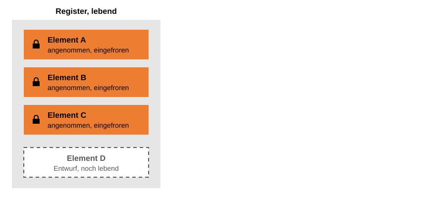
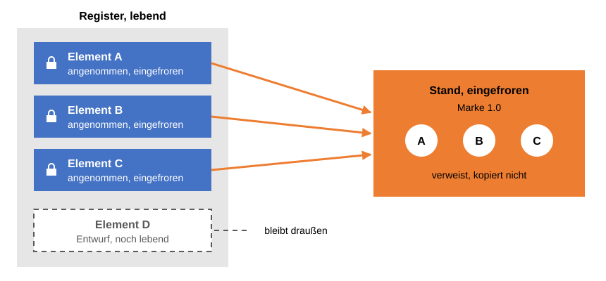
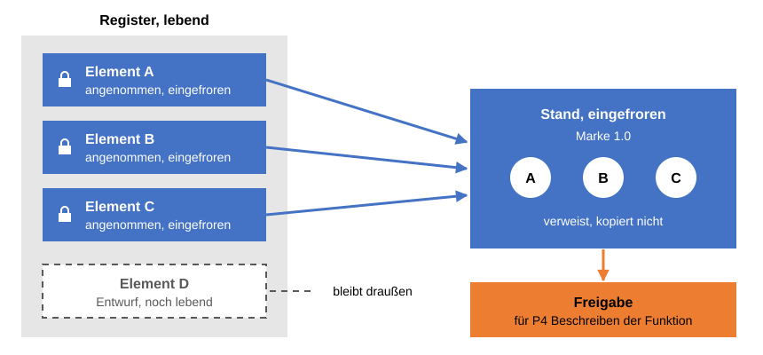

# Freigabedokument: Sammler und Freezer

> **Stand der Quellen:** [referenzprozess-softwareentwicklung](https://github.com/schlingensiepen/referenzprozess-softwareentwicklung) `release-2.0`, `docs/Staende-Freigaben-Marken.md`.

Im Wiki ändert sich ständig etwas. Das ist gewollt, denn das Wiki ist lebendes Wissen. Irgendwann soll sich aber jemand auf dieses Wissen verlassen: der nächste Arbeitsschritt, ein Prüfer, ein Kunde. Wer sich auf etwas verlässt, das sich morgen ändern kann, verlässt sich auf nichts. Dieses Kapitel zeigt das Dokument, das diesen Widerspruch auflöst. Es sammelt die Elemente, die zu einer Marke gehören, und friert sie als Ganzes ein. Das Skript nennt es [Freigabedokument](../Z-anhang/Z010-glossar.md#freigabedokument), weil es das ist, was später freigegeben wird. Der Titel sagt, was es tut: Es ist Sammler und Freezer, also das, was einfriert.

## Was im Register schon fest ist

Im Kapitel [Register und Elemente](../D-wissen-im-wiki/D040-register-und-elemente.md) haben Sie gesehen: Ein [Element](../Z-anhang/Z010-glossar.md#element) bekommt eine Nummer, und sobald es angenommen ist, ändert es sich nicht mehr. Wer es ändern will, legt ein neues Element an, das das alte ablöst. Das [Register](../Z-anhang/Z010-glossar.md#register) selbst lebt weiter. Es bekommt neue Elemente, Entwürfe reifen, Elemente werden abgelöst.

**Das Register lebt, seine Elemente frieren ein.** Ab der Annahme ändert sich ein Element nicht mehr.

Das Register ist also zugleich fest und beweglich. Die einzelnen angenommenen Elemente sind fest. Die Liste als Ganzes ist beweglich. Element D ist noch Entwurf. Morgen kann es angenommen sein, übermorgen kann ein Element E dazukommen. Wer sich heute auf „die Anforderungen“ beruft, beruft sich auf etwas, dessen Umfang sich laufend ändert. Das Einfrieren der einzelnen Elemente reicht dafür nicht.

## Das Freigabedokument sammelt

Nehmen Sie das Beispiel DONE. Die erste [Marke](F010-marken.md) umfasst das Backend und die Kommandozeile. Dafür sind im Register eine Reihe von Anforderungen angenommen worden. Bevor der Agent die Funktion beschreibt, muss feststehen, welche Anforderungen die Grundlage dafür sind. Also bildet er ein Dokument, das genau diese zusammenstellt: die Anforderungen der ersten Marke. Es liegt nicht im Wiki, sondern im Ordner `output/` des Projekts.

Das Regelwerk nennt ein solches Dokument einen [Stand](../Z-anhang/Z010-glossar.md#stand), und seine wichtigste Regel dazu lautet: Ein Stand wird nur aus Eingefrorenem gebildet. In den Bildern dieses Kapitels steht dieses kürzere Wort.

Was gehört also hinein? Angenommene Elemente, sonst nichts. Das Freigabedokument verweist auf diese Elemente, es kopiert sie nicht. Das reicht, weil ein angenommenes Element sich nicht mehr ändert: Die Nummer zeigt heute und in einem Jahr auf denselben Inhalt. Was noch Entwurf ist, bleibt draußen.

Der Agent prüft das, bevor er das Dokument bildet. Er legt Ihnen vor, was dazugehört, aber noch nicht angenommen ist, im Bild das Element D. Sie entscheiden je Punkt: jetzt annehmen oder weglassen. Was Sie weglassen, vermerkt der Agent im Kopf des Dokuments. Wer trotzdem alles hineinnimmt, auch die Entwürfe, bekommt eine Momentaufnahme. Die darf man sich ansehen, aber nicht freigeben, denn sie kann sich noch ändern.

**Der Stand sammelt und friert ein.** Er verweist nur auf Eingefrorenes, Element D bleibt draußen.

Ein Register speist dabei oft mehrere Freigabedokumente, und ein Freigabedokument zieht oft aus mehreren Registern. Die Anforderungen der ersten Marke sind ein Freigabedokument, die Anforderungen der zweiten Marke ein anderes. Dabei beschreibt das Dokument zu einer Marke immer das Ganze, nicht nur den Zuwachs: Was aus der ersten Marke weiter gilt, steht auch im Dokument zur zweiten.

## Das Freigabedokument friert ein

Im Register friert das einzelne Element ein. Hier friert die Zusammenstellung ein: welche Elemente dazugehören, zu welcher Marke, an welchem Tag gebildet. Das steht im Kopf des Dokuments, zusammen mit dem Zweck und den Dokumenten, auf denen es aufbaut. Das Freigabedokument gehört zu genau einer Marke.

Dazu kommt etwas, das man leicht übersieht. Nicht alles, worauf ein Element sich stützt, ist eingefroren. Das Glossar lebt, die Rollen leben, das Mission Statement lebt. Eine Anforderung, die von „Benutzern“ spricht, meint den Begriff aus dem Glossar. Ändert sich der Glossar-Eintrag, ändert sich die Bedeutung der Anforderung, ohne dass an ihr ein Buchstabe geändert wurde. Deshalb legt der Agent neben das Freigabedokument Kopien dieser lebenden Dateien, als Kopie gekennzeichnet und unveränderlich. So ändert sich unter einer Freigabe nichts weg.

Und wenn sich doch etwas ändert? Wird ein Element abgelöst, auf das das Dokument verweist, und gilt der Nachfolger für dieselbe Marke, dann ist das Dokument überholt. Es wird nicht nachgebessert. Der Agent bildet ein neues Freigabedokument, eine neue Version, und das alte bleibt unverändert liegen. Dass ein Dokument überholt ist, muss niemand von Hand nachhalten, der Agent erkennt und meldet es.

## Freigegeben wird das Freigabedokument

Wozu der Aufwand? Damit eine [Freigabe](../Z-anhang/Z010-glossar.md#freigabe) etwas Festes hat, worauf sie sich bezieht. Freigegeben wird nie das lebende Register und nie ein einzelnes Element, sondern immer das Freigabedokument. Im Beispiel DONE sind das die Anforderungen der ersten Marke, freigegeben für den nächsten Schritt, das Beschreiben der Funktion. Im Regelwerk heißt dieser Schritt Phase P4, so steht es im Bild.

**Freigegeben wird der Stand.** Die Freigabe gilt für einen Zweck, hier für das Beschreiben der Funktion.

Die Freigabe gilt für genau dieses eingefrorene Dokument, und sie wird nicht zurückgenommen. Ist das Dokument überholt, bekommt das neue Dokument eine neue Freigabe, die die alte ablöst. Was „freigegeben für“ bedeutet und warum eine Freigabe immer einen Zweck nennt, ist das Thema des nächsten Kapitels.

## Was jetzt klar sein sollte

- Im Register ist jedes angenommene Element fest, die Zusammenstellung aber nicht. Darauf allein kann sich niemand verlassen.
- Das Freigabedokument sammelt die angenommenen Elemente einer Marke. Es verweist auf sie, statt sie zu kopieren, und nimmt nur Eingefrorenes auf. Lebende Dateien wie das Glossar legt der Agent als Kopie daneben.
- Es friert die Zusammenstellung ein. Ändert sich danach etwas, entsteht ein neues Dokument, das alte bleibt liegen.
- Freigegeben wird nie das Register, sondern immer das Freigabedokument.

Weiter mit [Freigabe von x für y](F030-freigabe-von-x-fuer-y.md).
