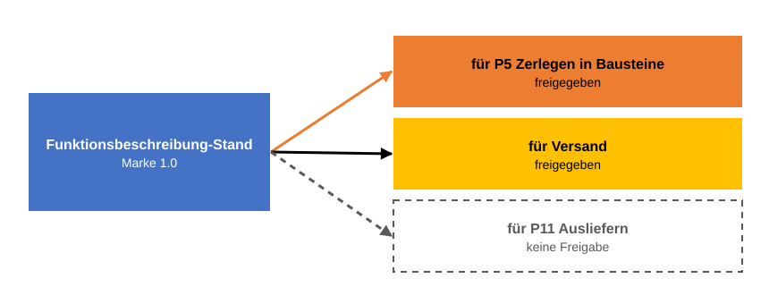

# Freigabe von x für y

> **Stand der Quellen:** [referenzprozess-softwareentwicklung](https://github.com/schlingensiepen/referenzprozess-softwareentwicklung) `release-2.0`, `docs/Staende-Freigaben-Marken.md`.

Das vorige Kapitel endete mit einer offenen Frage: Was heißt „freigegeben für“, und warum nennt eine Freigabe immer einen Zweck? Im Alltag ist eine Freigabe ein Stempel: Das Dokument ist fertig, man darf es benutzen. Dieses Kapitel zeigt, warum das zu wenig ist. Eine [Freigabe](../Z-anhang/Z010-glossar.md#freigabe) sagt nie nur „gut“, sie sagt „gut für y“. Das ist das tragende Konzept des ganzen Teils F.

## Ein Beispiel aus dem Fahrzeugbau

In der Fahrzeugentwicklung wird eine Planung nicht einfach freigegeben, sondern für etwas: diese Planung für die Detaillierung, dieser Detaillierungsgrad für die Bestellung der Werkzeuge, dieser Werkzeugplan für die Vorbereitung der Produktion. Für eine Messe wird eine Version eingefroren, die genau diesem Zweck dient. Dass eine Version für die Messe taugt, heißt nicht, dass man danach Werkzeuge bestellen darf. Jede Freigabe beantwortet eine andere Frage, und wer sich auf ein Dokument verlässt, muss wissen, welche Frage beantwortet ist.

Software ist da nicht anders. Eine Funktionsbeschreibung kann gut genug sein, damit jemand daraus die Bausteine des Systems ableitet, und trotzdem nicht gut genug, um danach auszuliefern.

## Eine Freigabe nennt immer einen Zweck

Jedes [Freigabedokument](../Z-anhang/Z010-glossar.md#freigabedokument) kann keine, eine oder mehrere Freigaben tragen, und jede ist an einen Zweck gebunden. Der Zweck ist meist die nächste [Phase](../Z-anhang/Z010-glossar.md#phase): Die Funktionsbeschreibung wird freigegeben „für P5 Zerlegen in Bausteine“, und das heißt genau: Wer die Bausteine entwirft, darf diese Funktionsbeschreibung als verlässliche Grundlage nehmen. Ob dasselbe Dokument „für P11 Ausliefern“ freigegeben ist, ist eine andere Frage mit einer eigenen Antwort. Freigaben sind unabhängig voneinander, eine impliziert keine andere. Das Regelwerk nennt eine solche Freigabe [Zweck-Freigabe](../Z-anhang/Z010-glossar.md#zweck-freigabe).

**Eine Freigabe gilt für einen Zweck.** Derselbe Stand kann für einen Zweck freigegeben sein und für einen anderen nicht, eine Freigabe impliziert keine andere.

Im Bild sehen Sie die Funktionsbeschreibung zur Marke 1.0 von DONE, dort mit dem Wort des Regelwerks als Stand bezeichnet. Sie trägt zwei Freigaben. Die erste gilt für das Zerlegen in Bausteine: Die Architektur von Backend und Kommandozeile darf darauf aufbauen. Die zweite gilt für den Versand: Sie haben das Dokument an jemanden außerhalb des Projekts geschickt, um eine Rückmeldung zu bekommen, und die Freigabe hält fest, welche Version das war. Ein Zweck muss also keine Phase sein. Versand, ein Test durch Anwender oder der Auftrag an einen [Subagenten](../Z-anhang/Z010-glossar.md#subagent), einen Hilfs-Agenten mit eigenem Kontext, sind freie Zwecke. Für das Ausliefern dagegen gibt es keine Freigabe, und keine der beiden anderen ersetzt sie.

## Die Formel

Eine Freigabe ist eine [Entscheidung](../Z-anhang/Z010-glossar.md#entscheidung) und steht als solche im Register, mit Nummer und Verweis auf das Dokument. Ihr Wortlaut ist fest:

> Stand x von ⟨Artefakt⟩, freigegeben für Zweck Z [zu Marke M]

x ist die Version des Dokuments, ⟨Artefakt⟩ seine Art, etwa Anforderungen oder Funktionsbeschreibung, und Z der Zweck: eine Phase mit ihrem Tätigkeitsnamen oder ein freier Zweck. Für DONE lautet der Eintrag zur Freigabe aus dem vorigen Kapitel etwa „Stand 01_MUS von Anforderungen, freigegeben für P4 Beschreiben der Funktion“, wobei `01_MUS` die erste Version mit Ihrem Bearbeiter-Kürzel ist, im Beispiel `MUS`. Das Wort „Zweck“ darf dabei entfallen. Der Wortlaut ist verbindlich, weil ein Prüfprogramm, der [Lint](../Z-anhang/Z010-glossar.md#lint), Freigaben im Register an genau dieser Form erkennt. Deshalb fällt hier das Wort Stand: Es ist Teil der Formel.

Die eckigen Klammern zeigen, dass der Zusatz „zu Marke M“ nicht immer dasteht. Die Marke steht schon im Kopf des Freigabedokuments. Der Zusatz wiederholt sie nur und steht, wenn sie nicht die laufende Marke ist. Läuft 1.1 und werden schon Anforderungen zu 2.0 freigegeben, heißt es also „Stand 01_MUS von Anforderungen, freigegeben für P4 Beschreiben der Funktion zu Marke 2.0“. Immer steht der Zusatz, wenn es kein Freigabedokument gibt, denn dann ist der Eintrag die einzige Stelle, die die Marke nennt. Das betrifft die Freigabe des Produkts selbst. Sie läuft über eine Markierung in Git, den [Git-Tag](../Z-anhang/Z010-glossar.md#tag), und das Kapitel [Softwareentwicklung als Prozess](../G-der-gesamtprozess/G010-softwareentwicklung-als-prozess.md) erklärt sie.

Bei den Dokumenten, die der Prozess verlangt, verweist der Eintrag außerdem auf den Bericht des Prüfers, der das Dokument vor der Freigabe gegen seine Vorgänger geprüft hat. Eine Einschränkung steht ausdrücklich dabei, etwa dass ein Vorgänger fehlt oder dass Prüfer und Ersteller dasselbe Modell waren. Was geprüft wird und von wem, ist Thema von [Prüfen](../G-der-gesamtprozess/G020-pruefen.md).

## Phasen ordnen Freigaben, nicht Arbeit

Jetzt lässt sich sagen, was die Phasen aus [Marken](F010-marken.md) eigentlich ordnen. Der Satz des Regelwerks dazu lautet: Phasen ordnen Freigaben, nicht Arbeit. Eine Anforderung, eine Technologie-Entscheidung, ein Testfall darf jederzeit entstehen und angenommen werden, sobald Sie es wissen. Geordnet ist allein, in welcher Reihenfolge die Freigabedokumente der Phasen freigegeben werden. Das Dokument einer Phase wird nach den Dokumenten der früheren Phasen derselben [Marke](../Z-anhang/Z010-glossar.md#marke) freigegeben, und vorher wird es gegen sie geprüft. Das Skript nennt diese Folge [Prüfkette](../Z-anhang/Z010-glossar.md#prüfkette); mehr dazu in [Softwareentwicklung als Prozess](../G-der-gesamtprozess/G010-softwareentwicklung-als-prozess.md). Fehlt ein früheres Dokument, ohne dass Sie bewusst darauf verzichtet haben, warnt der Agent; Sie entscheiden, und der Eintrag nennt den fehlenden Vorgänger. Gesperrt wird die Arbeit nie.

Der Übergang von einer Phase zur nächsten ist damit nichts anderes als eine Freigabe. „Jetzt habe ich genug Anforderungen, jetzt schreibe ich die Funktionsbeschreibung“ heißt im Regelwerk: Das Anforderungsdokument wird freigegeben für P4 Beschreiben der Funktion.

## Sich auf ein Dokument verlassen

Die Freigabe ist der Grund, warum sich jemand auf ein Dokument verlassen darf. Deshalb prüft der Agent sie, bevor er sich auf etwas bezieht: Arbeitet er an der Architektur und greift auf die Funktionsbeschreibung zu, prüft er, ob sie existiert und ob sie für diesen Zweck freigegeben ist. Fehlt eines von beiden, warnt er und nennt Ihnen die Möglichkeiten: trotzdem weiterarbeiten, erst die Freigabe erwirken oder den Bezug überdenken. Er blockiert nicht, Sie entscheiden.

Eine Freigabe gilt für das eingefrorene Dokument und wird nicht zurückgenommen. Ändert sich etwas, auf das das Dokument verweist, entsteht ein neues Dokument mit eigener Prüfung und eigener Freigabe, die die alte ablöst. Das alte bleibt liegen, und wer sich darauf verlassen hat, kann nachlesen, worauf.

Freigeben tun Sie. Der Agent legt vor, prüft die Vorbedingungen und bucht den Eintrag nach Ihrem OK. Sind die Vorbedingungen rein maschinell prüfbar, etwa dass alle Tests grün sind, bietet er an, solche Freigaben selbst zu buchen, generell oder je Fall. Die inhaltliche Prüfung bleibt bei Prüfern und Menschen.

Zum Schluss eine Abgrenzung. Wenn Sie dem Agenten erlauben, einen einzelnen Befehl auszuführen, wie in [Die erste Sitzung](../A-verstehen-und-loslegen/A040-die-erste-sitzung.md), ist das auch eine Freigabe, aber eine andere: eine Erlaubnis für eine Handlung, keine Aussage über ein Dokument. In diesem Teil geht es nur um die zweite.

## Was jetzt klar sein sollte

- Eine Freigabe sagt nie nur „gut“, sondern „gut für y“: für eine Phase oder einen freien Zweck wie Versand.
- Ein Dokument kann für einen Zweck freigegeben sein und für einen anderen nicht. Keine Freigabe impliziert eine andere.
- Die Freigabe ist eine Entscheidung im Register mit festem Wortlaut: Stand x von ⟨Artefakt⟩, freigegeben für Zweck Z [zu Marke M]. Der Zusatz steht, wenn die Marke nicht die laufende ist oder es kein Freigabedokument gibt.
- Phasen ordnen Freigaben, nicht Arbeit. Der Übergang zur nächsten Phase ist eine Freigabe.
- Eine Freigabe wird nicht zurückgenommen. Ändert sich etwas, gibt es ein neues Dokument mit neuer Freigabe.

Damit ist Teil F zu Ende. Weiter mit [Softwareentwicklung als Prozess](../G-der-gesamtprozess/G010-softwareentwicklung-als-prozess.md): der ganze Weg einer Marke durch die Phasen, mit der Prüfung vor jeder Freigabe.
